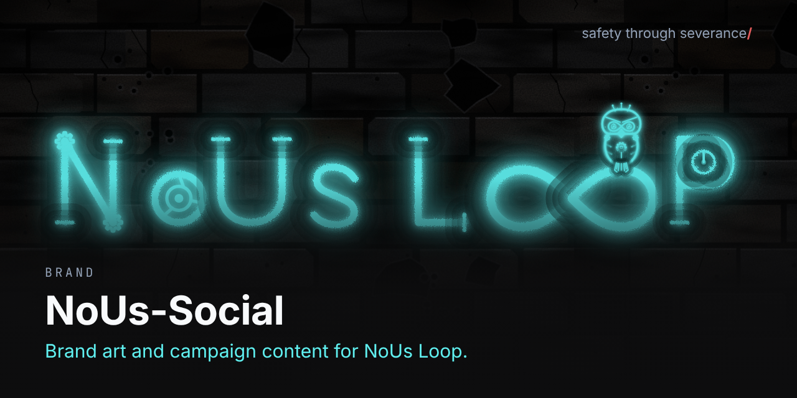

# NoUs-Social

Brand art, campaign material and the content workflow for NoUs Loop. NoUs Loop builds calm, private tools for neurodivergent minds that run on your own devices. We never sell your data.

**Status:** maintenance. This repo holds brand assets and drafts. Nothing here publishes automatically.

## What's here

- **Brand art:** logos, the loop icon and campaign posters (root folder).
- **Content workflow:** how posts are drafted, reviewed and approved ([CONTENT_OPS.md](CONTENT_OPS.md), [drafts/](drafts/README.md)).
- **Planning:** [content-calendar.md](content-calendar.md) and [SOCIAL_PROGRESS.md](SOCIAL_PROGRESS.md).
- **Website copy:** text for our sites ([website-content/](website-content/)).

## How content goes out

1. A draft is written into `drafts/<platform>/`.
2. A person reviews and approves it.
3. It's posted by hand or through the approved publishing tool.

No draft goes live without human approval.

## Privacy

This repo holds no personal or customer data. Drafts never include anyone's private information.

## Contributing and security

Open an issue to suggest content. To report a security problem, use **Report a vulnerability** on this repository's Security tab, which opens a private advisory only the maintainers can see. Please don't open a public issue for it.

## License

All brand assets © NoUs Loop Solutions. All rights reserved. Please don't reuse the logos or artwork without permission.
